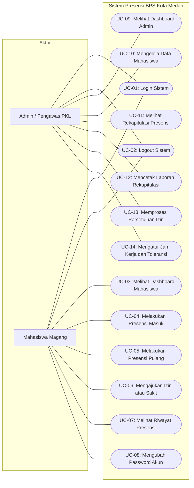

# Dokumentasi Use Case Sistem Presensi Mahasiswa Magang

Dokumen ini mendefinisikan batas sistem, identifikasi aktor, pemetaan fungsionalitas sistem, serta skenario penggunaan terperinci dari aplikasi Sistem Presensi Mahasiswa Magang BPS Kota Medan berdasarkan kode sumber yang diimplementasikan.

---

## 1. Diagram Use Case

Diagram di bawah ini menggambarkan interaksi antara dua aktor utama (*Mahasiswa* dan *Admin/Pengawas PKL*) dengan seluruh fungsionalitas sistem:

---

## 2. Tabel Identifikasi Use Case

Seluruh use case yang tercantum di bawah ini didasarkan langsung pada berkas pengendali tampilan dan pemroses logika pada aplikasi:

| ID Use Case | Nama Use Case | Aktor | Deskripsi Singkat | Berkas Implementasi PHP |
|---|---|---|---|---|
| **UC-01** | Login Sistem | Admin, Mahasiswa | Melakukan autentikasi menggunakan username dan password serta mengarahkan ke antarmuka sesuai peran. | `auth/login.php` |
| **UC-02** | Logout Sistem | Admin, Mahasiswa | Menghancurkan sesi pengguna aktif dan mengembalikan pengguna ke halaman login. | `auth/logout.php` |
| **UC-03** | Melihat Dashboard Mahasiswa | Mahasiswa | Menampilkan status presensi hari ini, ringkasan kehadiran bulan berjalan, dan notifikasi izin menunggu. | `mahasiswa/dashboard.php` |
| **UC-04** | Melakukan Presensi Masuk | Mahasiswa | Mencatat waktu kehadiran masuk kerja berdasarkan waktu server dan menentukan status hadir atau terlambat. | `mahasiswa/presensi.php` |
| **UC-05** | Melakukan Presensi Pulang | Mahasiswa | Mencatat waktu kepulangan kerja berdasarkan waktu server untuk presensi yang telah masuk hari ini. | `mahasiswa/presensi.php` |
| **UC-06** | Mengajukan Izin atau Sakit | Mahasiswa | Mengirim permohonan ketidakhadiran kerja dengan alasan serta unggah berkas bukti pendukung. | `mahasiswa/izin.php` |
| **UC-07** | Melihat Riwayat Presensi | Mahasiswa | Menampilkan log kehadiran bulanan mandiri beserta kartu ringkasan status hadir, terlambat, izin, sakit, dan alfa. | `mahasiswa/riwayat.php` |
| **UC-08** | Mengubah Password Akun | Mahasiswa | Memperbarui kata sandi akun mahasiswa dengan memvalidasi kecocokan kata sandi lama. | `mahasiswa/ganti_password.php` |
| **UC-09** | Melihat Dashboard Admin | Admin | Memantau ringkasan statistik kehadiran hari ini, daftar hadir harian mahasiswa aktif, dan jumlah izin menunggu. | `admin/dashboard.php` |
| **UC-10** | Mengelola Data Mahasiswa | Admin | Menambah data mahasiswa baru, mengubah biodata, mengubah status aktif/nonaktif, dan menghapus data akun mahasiswa. | `admin/mahasiswa.php`, `admin/mahasiswa_form.php` |
| **UC-11** | Melihat Rekapitulasi Presensi | Admin | Menyaring dan meninjau data kehadiran seluruh atau perorangan mahasiswa berdasarkan rentang tanggal dan status. | `admin/rekap.php` |
| **UC-12** | Mencetak Laporan Rekapitulasi | Admin | Menghasilkan dokumen laporan presensi formal siap cetak atau simpan PDF tanpa elemen navigasi antarmuka web. | `admin/rekap_cetak.php`, `admin/rekap.php` |
| **UC-13** | Memproses Persetujuan Izin | Admin | Menyetujui pengajuan izin (yang otomatis memutakhirkan tabel presensi) atau menolak permohonan izin mahasiswa. | `admin/izin.php` |
| **UC-14** | Mengatur Jam Kerja dan Toleransi | Admin | Mengatur batas waktu jam masuk, jam pulang, dan menit toleransi keterlambatan pada tabel pengaturan. | `admin/pengaturan.php` |

---

## 3. Skenario Use Case Utama

Berikut adalah spesifikasi skenario rinci untuk empat proses bisnis inti pada sistem:

### 3.1. Skenario UC-04: Melakukan Presensi Masuk
- **Aktor Utama**: Mahasiswa Magang.
- **Prasyarat**:
  1. Mahasiswa telah terautentikasi dan memiliki status akun `aktif`.
  2. Hari saat ini adalah hari kerja (Senin sampai Jumat).
  3. Tanggal hari ini berada di dalam rentang `tgl_mulai` dan `tgl_selesai` pada data mahasiswa.
  4. Mahasiswa belum memiliki catatan presensi pada tanggal hari ini.
- **Alur Normal**:
  1. Mahasiswa mengakses menu presensi melalui berkas `mahasiswa/presensi.php`.
  2. Sistem memverifikasi kondisi kelayakan presensi dan mengaktifkan tombol `Presensi Masuk`.
  3. Mahasiswa menekan tombol `Presensi Masuk` (metode POST dengan parameter `aksi = masuk`).
  4. Sistem mengambil jam server PHP saat ini.
  5. Sistem mengambil konfigurasi jam kerja (`jam_masuk` dan `toleransi_menit`) dari tabel `pengaturan`.
  6. Sistem menghitung batas toleransi jam masuk (`jam_masuk + toleransi_menit`).
  7. Sistem membandingkan jam server dengan batas toleransi:
     - Jika jam server kurang dari atau sama dengan batas toleransi, status ditentukan sebagai `hadir`.
     - Jika jam server melewati batas toleransi, status ditentukan sebagai `terlambat`.
  8. Sistem menyimpan baris data baru ke tabel `presensi` dengan kolom `user_id`, `tanggal`, `jam_masuk`, dan `status`.
  9. Sistem menetapkan pesan notifikasi kilat (*flash message*) sukses: `"Presensi masuk berhasil. Status: [Hadir/Terlambat]."`
  10. Sistem mengalihkan (*redirect*) kembali ke halaman `mahasiswa/presensi.php`.
  11. Halaman menampilkan waktu masuk dan label status kehadiran terbaru, serta menonaktifkan tombol presensi masuk.
- **Alur Alternatif**:
  - **4a. Akses di luar hari kerja**: Jika mahasiswa mengakses tombol pada hari Sabtu atau Minggu, sistem menolak proses dan memberikan pesan: `"Presensi hanya bisa pada hari Senin sampai Jumat."`
  - **4b. Akses di luar periode magang**: Jika tanggal server berada sebelum `tgl_mulai` atau sesudah `tgl_selesai`, sistem menolak proses dan memberikan pesan: `"Hari ini di luar periode magang Anda."`
  - **4c. Presensi ganda**: Jika sebelum tombol ditekan baris presensi hari ini sudah ada (atau terjadi pengiriman ganda bersamaan dengan galat kode SQL 23000), sistem membatalkan penyimpanan dan memberikan pesan: `"Anda sudah presensi hari ini."`
- **Hasil Akhir**: Catatan presensi masuk tersimpan di tabel `presensi` dengan status kehadiran `hadir` atau `terlambat`.

---

### 3.2. Skenario UC-06: Mengajukan Izin atau Sakit
- **Aktor Utama**: Mahasiswa Magang.
- **Prasyarat**:
  1. Mahasiswa telah login.
  2. Tanggal yang diajukan berada pada hari kerja (Senin sampai Jumat).
  3. Tanggal yang diajukan tidak lebih lampau dari hari ini.
  4. Tanggal berada di dalam masa aktif magang mahasiswa.
  5. Belum ada catatan presensi maupun pengajuan izin lain berstatus menunggu atau disetujui pada tanggal yang dipilih.
- **Alur Normal**:
  1. Mahasiswa membuka halaman formulir pengajuan izin melalui `mahasiswa/izin.php`.
  2. Mahasiswa mengisi tanggal, memilih jenis pengajuan (`izin` atau `sakit`), mengisikan teks alasan, dan memilih berkas bukti (wajib untuk sakit, opsional untuk izin).
  3. Mahasiswa menekan tombol `Kirim Pengajuan`.
  4. Sistem memvalidasi kelengkapan isian formulir dan aturan tanggal.
  5. Sistem memeriksa keberadaan berkas unggahan:
     - Memeriksa batas ukuran berkas tidak melebihi 2 MB (2.097.152 bita).
     - Memeriksa ekstensi berkas (`jpg`, `jpeg`, `png`, `pdf`).
     - Memeriksa tipe MIME berkas secara riil menggunakan `finfo` (`image/jpeg`, `image/png`, `application/pdf`).
  6. Sistem menghasilkan nama berkas acak yang unik (`bin2hex(random_bytes(8)) . '.' . $ekstensi`) dan memindahkan berkas ke folder `assets/uploads/`.
  7. Sistem menyimpan data pengajuan ke tabel `izin` dengan status `menunggu`.
  8. Sistem menetapkan pesan sukses: `"Pengajuan berhasil dikirim dan menunggu persetujuan admin."`
  9. Sistem melakukan pengalihan kembali ke `mahasiswa/izin.php`.
  10. Tabel riwayat pengajuan di bagian bawah formulir menampilkan baris baru dengan lencana status berwarna kuning (`Menunggu`).
- **Alur Alternatif**:
  - **4a. Kolom wajib kosong**: Jika tanggal, jenis, atau alasan kosong, sistem menolak dengan pesan: `"Tanggal, jenis pengajuan, dan alasan wajib diisi."`
  - **4b. Tanggal telah berlalu**: Jika tanggal input lebih kecil dari hari ini, sistem menolak dengan pesan: `"Tanggal pengajuan tidak boleh lebih lampau dari hari ini."`
  - **4c. Tanggal akhir pekan**: Jika tanggal jatuh pada hari Sabtu atau Minggu, sistem menolak dengan pesan: `"Pengajuan hanya dapat dilakukan untuk hari kerja (Senin sampai Jumat)."`
  - **4d. Tanggal di luar magang**: Jika tanggal di luar rentang magang, sistem menolak dengan pesan: `"Tanggal pengajuan harus berada dalam rentang periode magang Anda."`
  - **4e. Presensi sudah ada**: Jika mahasiswa sudah presensi pada tanggal tersebut, sistem menolak dengan pesan: `"Anda sudah memiliki catatan presensi pada tanggal tersebut."`
  - **4f. Izin ganda**: Jika izin menunggu atau disetujui sudah ada pada tanggal tersebut, sistem menolak dengan pesan: `"Pengajuan izin/sakit untuk tanggal tersebut sudah pernah diajukan sebelumnya."`
  - **5a. Sakit tanpa surat**: Jika jenis sakit dipilih namun berkas bukti tidak dilampirkan, sistem menolak dengan pesan: `"Bukti surat dokter/keterangan sakit wajib diunggah untuk jenis sakit."`
  - **5b. Berkas tidak valid atau terlalu besar**: Jika berkas melebihi 2 MB, berekstensi ilegal, atau MIME palsu, sistem menolak dengan pesan kesalahan terkait dan tidak menyimpan data.
  - **7a. Kegagalan simpan basis data**: Jika terjadi galat sistem saat eksekusi query INSERT, sistem otomatis menghapus fisik berkas bukti yang sempat terunggah dan menampilkan pesan: `"Terjadi kesalahan sistem saat menyimpan pengajuan."`
- **Hasil Akhir**: Data izin tersimpan pada tabel `izin` dengan status `menunggu` dan berkas bukti tersimpan aman di direktori unggahan.

---

### 3.3. Skenario UC-13: Memproses Persetujuan Izin
- **Aktor Utama**: Admin / Pengawas PKL.
- **Prasyarat**:
  1. Admin telah terautentikasi ke dalam sistem.
  2. Terdapat data permohonan izin dengan status `menunggu` pada tabel `izin`.
- **Alur Normal (Persetujuan Permohonan)**:
  1. Admin membuka halaman persetujuan izin melalui `admin/izin.php`.
  2. Sistem menampilkan daftar izin dengan penyaring default berstatus `menunggu`.
  3. Admin meninjau data mahasiswa, tanggal, alasan, dan berkas bukti pendukung.
  4. Admin menekan tombol `Setujui` pada baris permohonan terkait.
  5. Sistem memulai transaksi basis data PDO (`beginTransaction`).
  6. Sistem mengunci baris data izin menggunakan query `SELECT ... FOR UPDATE` dan memastikan status permohonan masih bernilai `menunggu`.
  7. Sistem memeriksa tabel `presensi` pada tanggal dan mahasiswa bersangkutan untuk memastikan belum ada presensi masuk (`jam_masuk IS NULL`).
  8. Sistem memperbarui status pada tabel `izin` menjadi `disetujui`.
  9. Sistem menjalankan query upsert (`INSERT INTO presensi ... ON DUPLICATE KEY UPDATE`) untuk mencatat baris tanggal tersebut dengan status sesuai jenis izin (`izin` atau `sakit`), kolom keterangan diisi alasan mahasiswa, serta kolom `jam_masuk` dan `jam_pulang` bernilai `NULL`.
  10. Sistem mengonfirmasi transaksi (`commit`).
  11. Sistem menetapkan pesan sukses: `"Pengajuan izin berhasil disetujui dan data presensi telah diperbarui."`
  12. Sistem mengalihkan halaman kembali ke `admin/izin.php`.
- **Alur Alternatif (Penolakan Permohonan)**:
  - **4a. Admin memilih Tolak**: Admin menekan tombol `Tolak`.
  - **4b. Proses penolakan**: Sistem memperbarui status izin menjadi `ditolak` pada tabel `izin` tanpa mengubah tabel `presensi`.
  - **4c. Hasil tolak**: Sistem menetapkan pesan: `"Pengajuan izin berhasil ditolak."` dan melakukan redirect.
- **Alur Alternatif (Kondisi Khusus)**:
  - **7a. Mahasiswa telah presensi masuk**: Jika ditemukan bahwa pada tanggal tersebut mahasiswa telah melakukan presensi masuk (`jam_masuk` tidak kosong), sistem membatalkan seluruh transaksi (`rollBack`) dan menampilkan pesan: `"Persetujuan dibatalkan: Mahasiswa bersangkutan sudah melakukan presensi pada tanggal tersebut."`
  - **6a. Status telah berubah**: Jika permohonan sudah tidak lagi berstatus menunggu saat tombol diproses, transaksi dibatalkan dengan pesan: `"Pengajuan tidak ditemukan atau sudah tidak berstatus menunggu."`
- **Hasil Akhir**: Status izin berubah menjadi `disetujui` dan tercatat otomatis pada rekapitulasi presensi, atau berubah menjadi `ditolak`.

---

### 3.4. Skenario UC-11 & UC-12: Rekapitulasi Presensi dan Cetak Laporan
- **Aktor Utama**: Admin / Pengawas PKL.
- **Prasyarat**:
  1. Admin telah berhasil login ke sistem.
- **Alur Normal**:
  1. Admin mengakses menu rekapitulasi melalui `admin/rekap.php`.
  2. Sistem menampilkan formulir filter tanggal awal (`tgl_dari`), tanggal akhir (`tgl_sampai`), pilihan mahasiswa (`user_id`), dan pilihan status presensi. Nilai default tanggal terisi otomatis dari tanggal 1 bulan berjalan sampai hari ini.
  3. Admin memilih rentang tanggal atau memilih mahasiswa spesifik, lalu menekan tombol `Tampilkan`.
  4. Sistem mengambil rekaman data presensi riil dari basis data dan mengompilasi perhitungan status alfa dinamis untuk hari kerja lampau yang tidak memiliki presensi di dalam periode magang mahasiswa.
  5. Sistem menyajikan kartu ringkasan total (hadir, terlambat, izin, sakit, alfa, total hari) dan tabel rincian harian mahasiswa.
  6. Admin menekan tombol `Cetak Laporan`.
  7. Sistem membuka tab baru peramban mengarah ke `admin/rekap_cetak.php` dengan membawa seluruh parameter query filter aktif.
  8. Halaman cetak merender dokumen format A4 resmi berisikan kop surat Badan Pusat Statistik Kota Medan, judul laporan, periode tanggal, identitas mahasiswa, tabel ringkasan kehadiran, tabel detail data presensi, serta titimangsa dan kolom tanda tangan pengawas magang tanpa bilah navigasi sistem.
  9. Peramban web secara otomatis memicu jendela dialog cetak sistem (*print dialog*) melalui pemanggilan skrip `window.print()`.
  10. Admin dapat langsung mencetak fisik ke mesin pencetak atau memilih opsi *Save as PDF*.
- **Alur Alternatif**:
  - **3a. Masukan tanggal terbalik**: Jika admin memasukkan tanggal akhir lebih awal dari tanggal awal, sistem secara otomatis menukar posisi kedua tanggal sehingga rentang pemrosesan tetap valid dan tidak menghasilkan galat.
  - **3b. Format tanggal tidak valid**: Jika parameter tanggal di URL dimanipulasi dengan teks sembarang, fungsi validasi tanggal internal mengembalikan tanggal ke setelan default yang aman (tanggal 1 bulan berjalan s/d hari ini).
  - **3c. Data kosong pada periode**: Jika tidak ada data kehadiran pada rentang filter, sistem menampilkan panel informasi pemberitahuan bahwa data tidak ditemukan.
- **Hasil Akhir**: Tampilan data rekapitulasi presensi disajikan secara terstruktur dan dokumen cetak resmi berhasil dihasilkan.