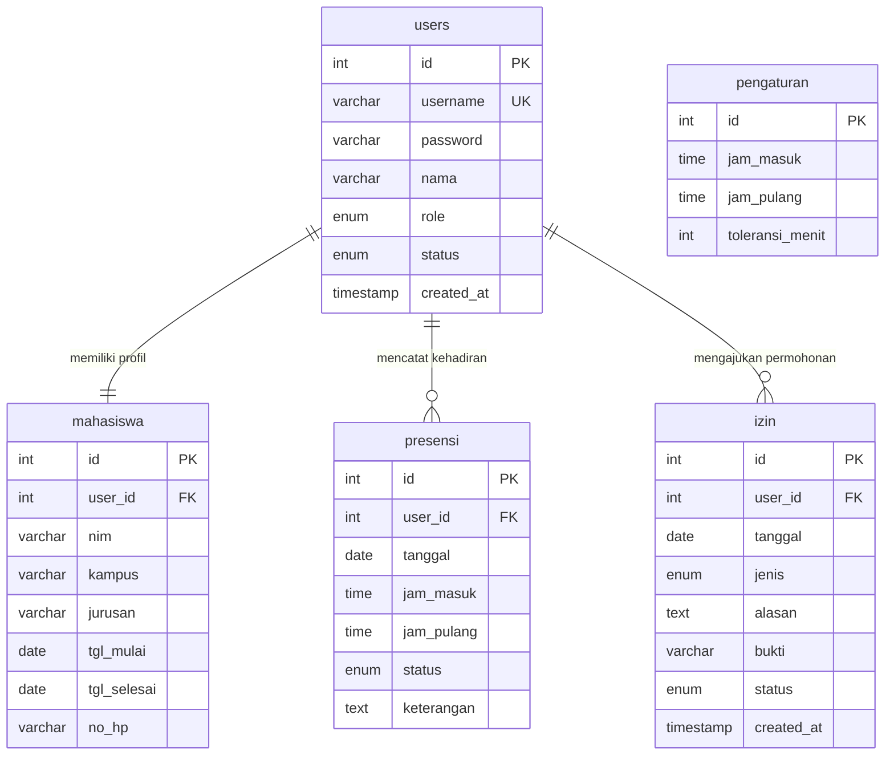

# Dokumentasi Model Data dan ERD (Entity Relationship Diagram)

Dokumen ini menyajikan pemodelan struktur data sistem informasi presensi berbasis basis data relasional MySQL/MariaDB. Skema ini dirancang mengacu pada berkas skrip DDL `database.sql` dengan menerapkan kaidah normalisasi dan aturan integritas referensial.

---

## 1. Entity Relationship Diagram (ERD)

Diagram relasi entitas berikut memetakan lima tabel basis data beserta kardinalitas dan kunci penghubung (*foreign key*):

---

## 2. Kamus Data (Data Dictionary)

Berikut adalah rincian struktur kolom, tipe data, pembatasan nilai, dan deskripsi fungsional untuk setiap tabel pada basis data `presensi_bps`:

### 2.1. Tabel `users`
Tabel ini menyimpan data akun autentikasi untuk seluruh pengguna sistem, baik administrator maupun peserta magang.

| Nama Kolom | Tipe Data | Panjang / Nilai | Boleh Null | Kunci | Nilai Default | Keterangan |
|---|---|---|---|---|---|---|
| `id` | INT | - | Tidak | PK | Auto Increment | Kunci primer identitas akun pengguna |
| `username` | VARCHAR | 50 | Tidak | UNIQUE | Tidak ada | Nama pengguna unik untuk login sistem |
| `password` | VARCHAR | 255 | Tidak | - | Tidak ada | Hash kata sandi terenkripsi (algoritma BCRYPT) |
| `nama` | VARCHAR | 100 | Tidak | - | Tidak ada | Nama lengkap pengguna |
| `role` | ENUM | `'admin'`, `'mahasiswa'` | Tidak | - | Tidak ada | Peran hak akses otorisasi sistem |
| `status` | ENUM | `'aktif'`, `'nonaktif'` | Tidak | - | `'aktif'` | Status operasional akun login |
| `created_at` | TIMESTAMP | - | Tidak | - | `CURRENT_TIMESTAMP` | Waktu pencatatan akun ke sistem |

---

### 2.2. Tabel `mahasiswa`
Tabel ini menyimpan atribut data diri akademik dan rentang waktu penugasan magang mahasiswa yang berelasi dengan tabel `users`.

| Nama Kolom | Tipe Data | Panjang / Nilai | Boleh Null | Kunci | Nilai Default | Keterangan |
|---|---|---|---|---|---|---|
| `id` | INT | - | Tidak | PK | Auto Increment | Kunci primer entitas mahasiswa |
| `user_id` | INT | - | Tidak | FK | Tidak ada | Kunci asing merujuk ke `users(id)` |
| `nim` | VARCHAR | 30 | Tidak | - | Tidak ada | Nomor Induk Mahasiswa dari instansi asal |
| `kampus` | VARCHAR | 100 | Tidak | - | Tidak ada | Nama universitas / perguruan tinggi asal |
| `jurusan` | VARCHAR | 100 | Tidak | - | Tidak ada | Program studi / jurusan asal mahasiswa |
| `tgl_mulai` | DATE | - | Tidak | - | Tidak ada | Tanggal awal periode masa magang |
| `tgl_selesai` | DATE | - | Tidak | - | Tidak ada | Tanggal akhir periode masa magang |
| `no_hp` | VARCHAR | 20 | Ya | - | `NULL` | Nomor kontak telepon / pesan mahasiswa |

---

### 2.3. Tabel `presensi`
Tabel transaksi harian yang menyimpan catatan waktu masuk, waktu kepulangan, status kehadiran, dan keterangan kehadiran kerja mahasiswa.

| Nama Kolom | Tipe Data | Panjang / Nilai | Boleh Null | Kunci | Nilai Default | Keterangan |
|---|---|---|---|---|---|---|
| `id` | INT | - | Tidak | PK | Auto Increment | Kunci primer catatan log presensi |
| `user_id` | INT | - | Tidak | FK, UNIQUE (1) | Tidak ada | Kunci asing merujuk ke `users(id)` |
| `tanggal` | DATE | - | Tidak | UNIQUE (2) | Tidak ada | Tanggal kalender catatan presensi |
| `jam_masuk` | TIME | - | Ya | - | `NULL` | Waktu presensi masuk dari server |
| `jam_pulang` | TIME | - | Ya | - | `NULL` | Waktu presensi pulang dari server |
| `status` | ENUM | `'hadir'`, `'terlambat'`, `'izin'`, `'sakit'`, `'alfa'` | Tidak | - | `'alfa'` | Klasifikasi status kehadiran harian |
| `keterangan` | TEXT | - | Ya | - | `NULL` | Alasan atau catatan keterangan presensi |

*Catatan pembatasan*: Kolom `user_id` dan `tanggal` diikat bersama dalam indeks `UNIQUE KEY uq_presensi_harian (user_id, tanggal)`.

---

### 2.4. Tabel `izin`
Tabel transaksi yang menampung pengajuan ketidakhadiran (izin dinas/keperluan penting atau sakit) beserta bukti berkas dan status persetujuannya.

| Nama Kolom | Tipe Data | Panjang / Nilai | Boleh Null | Kunci | Nilai Default | Keterangan |
|---|---|---|---|---|---|---|
| `id` | INT | - | Tidak | PK | Auto Increment | Kunci primer data permohonan izin |
| `user_id` | INT | - | Tidak | FK | Tidak ada | Kunci asing merujuk ke `users(id)` |
| `tanggal` | DATE | - | Tidak | - | Tidak ada | Tanggal izin yang dimohonkan |
| `jenis` | ENUM | `'izin'`, `'sakit'` | Tidak | - | Tidak ada | Kategori pengajuan ketidakhadiran |
| `alasan` | TEXT | - | Tidak | - | Tidak ada | Uraian penjelasan permohonan izin |
| `bukti` | VARCHAR | 255 | Ya | - | `NULL` | Nama berkas surat keterangan yang diunggah |
| `status` | ENUM | `'menunggu'`, `'disetujui'`, `'ditolak'` | Tidak | - | `'menunggu'` | Status pemrosesan oleh admin |
| `created_at` | TIMESTAMP | - | Tidak | - | `CURRENT_TIMESTAMP` | Waktu formulir diajukan oleh mahasiswa |

---

### 2.5. Tabel `pengaturan`
Tabel entitas konfigurasi mandiri satu baris yang mengatur jam operasional standar presensi kerja pada instansi.

| Nama Kolom | Tipe Data | Panjang / Nilai | Boleh Null | Kunci | Nilai Default | Keterangan |
|---|---|---|---|---|---|---|
| `id` | INT | - | Tidak | PK | Auto Increment | Kunci primer data konfigurasi |
| `jam_masuk` | TIME | - | Tidak | - | Tidak ada | Jam patokan masuk kerja (contoh: 08:00:00) |
| `jam_pulang` | TIME | - | Tidak | - | Tidak ada | Jam patokan pulang kerja (contoh: 16:00:00) |
| `toleransi_menit` | INT | - | Tidak | - | Tidak ada | Menit dispensasi toleransi keterlambatan |

---

## 3. Penjelasan Aturan Relasi dan Integritas Basis Data

Relasi antar entitas pada basis data `presensi_bps` didesain untuk menjamin konsistensi data secara terpadu melalui pembatasan kunci asing (*foreign key constraints*). Hubungan antara tabel induk `users` dengan tabel anak `mahasiswa`, `presensi`, dan `izin` didefinisikan dengan aturan klausul `ON UPDATE CASCADE ON DELETE CASCADE`. Hal ini bermakna bahwa apabila entitas akun pengguna diperbarui identitas ID-nya, perubahan akan merambat secara otomatis ke seluruh tabel turunan, dan apabila akun mahasiswa dihapus oleh administrator, seluruh data biodata magang, rekam jejak presensi harian, serta berkas riwayat perizinan milik mahasiswa tersebut akan otomatis dibersihkan dari basis data guna menghindari anomali data yatim (*orphaned records*).

Selain integritas referensial, keunikan data kehadiran dijamin melalui penerapan indeks komposit `UNIQUE KEY uq_presensi_harian (user_id, tanggal)` pada tabel `presensi`. Pembatasan unik ini secara mutlak membatasi bahwa seorang mahasiswa hanya dapat memiliki tepat satu baris rekaman presensi pada satu tanggal kalender tertentu. Penerapan indeks ini mencegah terjadinya duplikasi data akibat penekanan tombol ganda (*double-click*), *race condition* pada jaringan, maupun anomali logika perangkat lunak, serta memungkinkan sistem menggunakan query efisien berbasis `INSERT ... ON DUPLICATE KEY UPDATE` saat menyinkronkan persetujuan izin ke dalam tabel presensi.