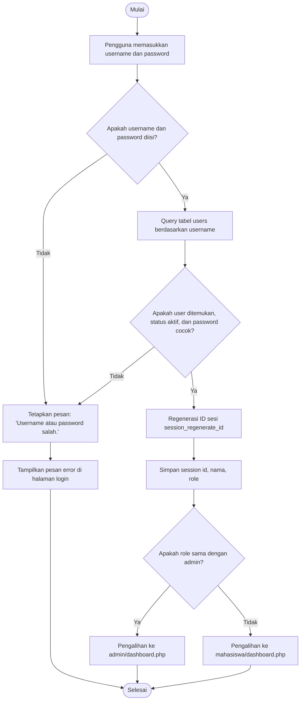
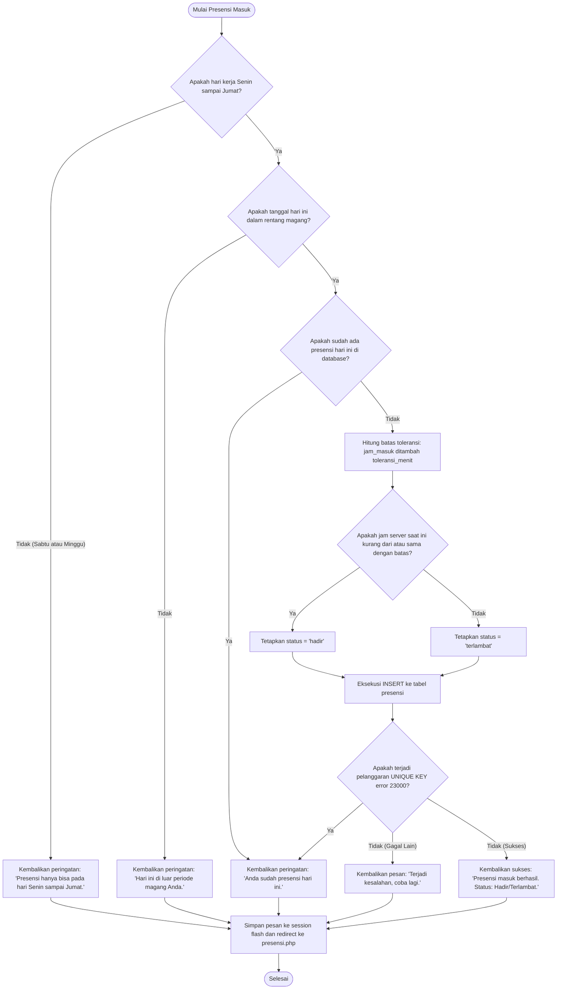
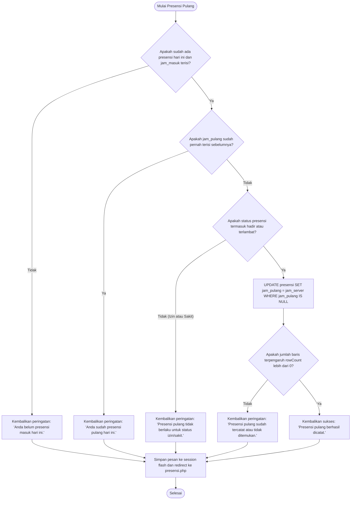
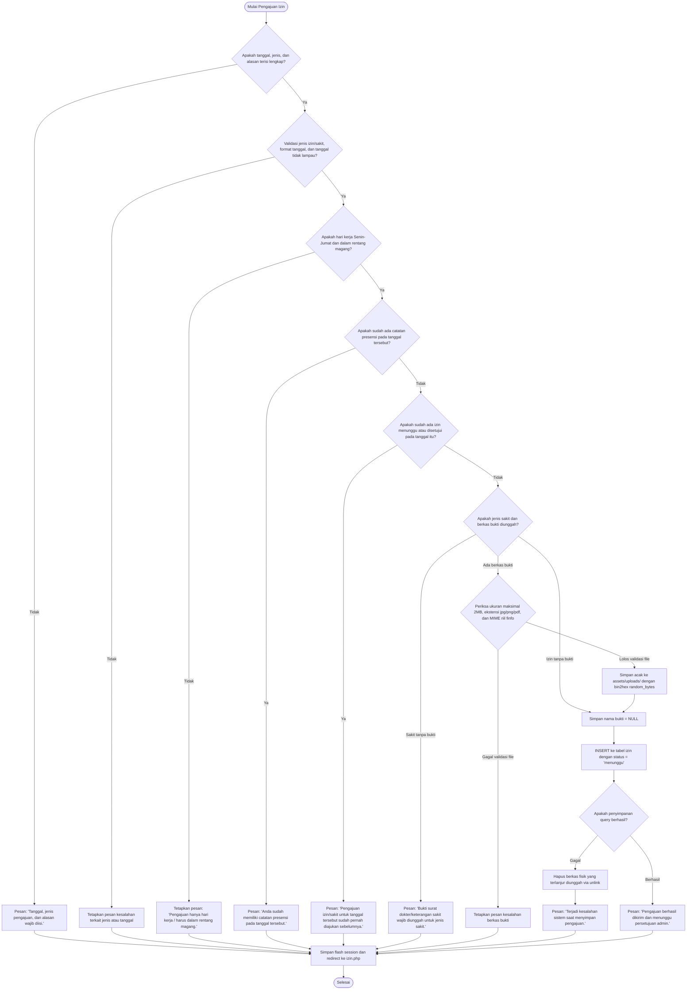
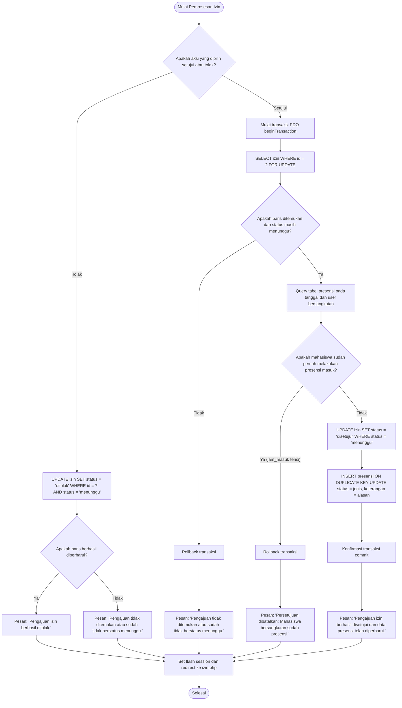
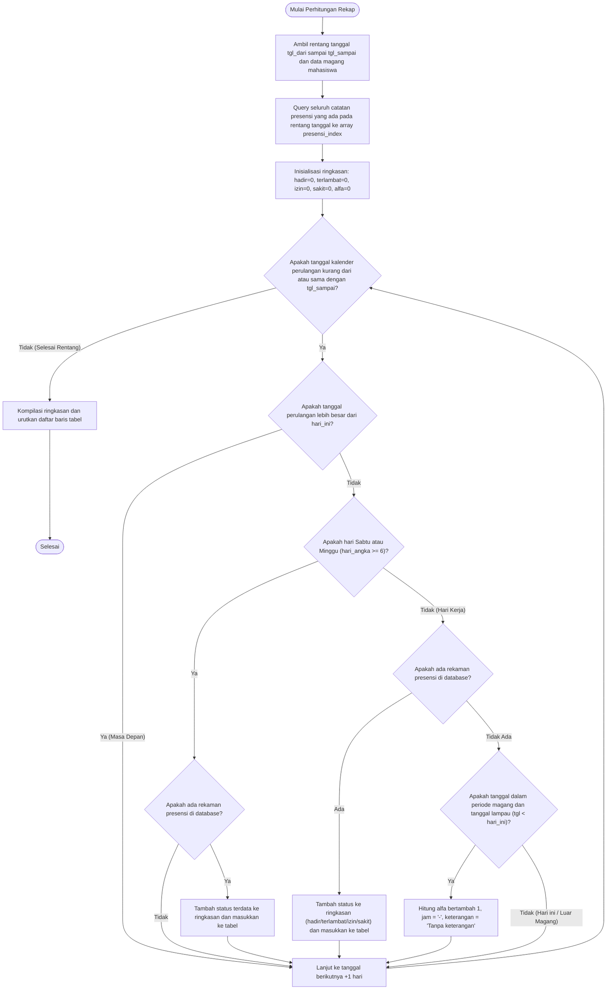

# Dokumentasi Diagram Alir Aktivitas (Activity Flowchart)

Dokumen ini memetakan seluruh logika pemrosesan data dan percabangan pengambilan keputusan di dalam sistem presensi. Seluruh urutan percabangan (*decision*) disusun secara runtut mengikuti urutan eksekusi logika pada kode sumber PHP aplikasi.

---

## 1. Alur Aktivitas Login dan Pengalihan Peran

Diagram alir berikut memetakan alur proses autentikasi akun pengguna dan pengalihan ke antarmuka yang sesuai berdasarkan peran (*role*) pada berkas `auth/login.php`:

### Penjelasan Alur Login
Proses dimulai ketika pengguna mengirimkan kredensial melalui formulir login. Sistem terlebih dahulu memvalidasi bahwa kedua kolom tidak kosong sebelum mengeksekusi *prepared statement* ke tabel `users`. Selanjutnya, sistem memverifikasi bahwa rekaman data ditemukan, kolom `status` bernilai `'aktif'`, dan fungsi `password_verify` menghasilkan kecocokan terhadap hash kata sandi. Apabila salah satu kondisi tidak terpenuhi, sistem mengembalikan pesan kegagalan generik `"Username atau password salah."` untuk mencegah teknik *username enumeration*. Setelah berhasil, sesi diperbarui dengan `session_regenerate_id(true)` dan pengguna dialihkan ke dashboard sesuai perannya.

---

## 2. Alur Aktivitas Presensi Masuk

Diagram alir berikut memetakan verifikasi aturan bisnis dan penentuan status kehadiran kerja pada fungsi `proses_masuk()` di berkas `mahasiswa/presensi.php`:

### Penjelasan Alur Presensi Masuk
Proses presensi masuk diawali dengan memeriksa apakah hari akses merupakan hari kerja (Senin sampai Jumat) dan memastikan tanggal server berada di dalam masa aktif magang mahasiswa. Sistem kemudian memeriksa apakah baris presensi hari ini telah tercatat untuk mencegah presensi berulang. Waktu server selanjutnya dibandingkan terhadap waktu batas masuk ditambah toleransi keterlambatan guna menentukan status `'hadir'` atau `'terlambat'`. Terakhir, kueri `INSERT` dijalankan dengan blok penangkap pengecualian integritas untuk menangani klik ganda secara aman sebelum pengguna dialihkan kembali ke antarmuka presensi.

---

## 3. Alur Aktivitas Presensi Pulang

Diagram alir berikut memetakan pemrosesan pencatatan waktu kepulangan kerja pada fungsi `proses_pulang()` di berkas `mahasiswa/presensi.php`:

### Penjelasan Alur Presensi Pulang
Pencatatan kepulangan kerja mewajibkan mahasiswa telah memiliki rekaman presensi masuk terlebih dahulu pada hari berjalan. Sistem memvalidasi bahwa kolom `jam_pulang` masih bernilai kosong dan status kehadiran bukan merupakan dispensasi izin atau sakit. Kueri `UPDATE` dieksekusi dengan memanfaatkan jam otoritatif server PHP dan membatasi pembaruan hanya pada baris yang belum memiliki waktu pulang. Hasil eksekusi dikonfirmasi melalui nilai `rowCount()` sebelum pesan status disimpan ke dalam sesi kilat dan halaman dimuat ulang.

---

## 4. Alur Aktivitas Pengajuan Izin dan Sakit oleh Mahasiswa

Diagram alir berikut memetakan tahapan validasi masukan formulir, verifikasi berkas bukti fisik, dan penyimpanan pengajuan pada berkas `mahasiswa/izin.php`:

### Penjelasan Alur Pengajuan Izin
Mahasiswa mengirimkan formulir izin dengan validasi ketat terhadap kelengkapan isian, format kalender, hari kerja, dan masa magang aktif. Sistem memastikan tidak ada konflik jadwal terhadap presensi harian maupun izin lain yang telah berstatus menunggu atau disetujui. Untuk pengajuan kategori sakit, surat dokter diwajibkan dan diverifikasi ukuran, ekstensi, serta tipe MIME aslinya sebelum disimpan menggunakan penamaan acak yang aman. Apabila kueri penyimpanan basis data gagal setelah berkas terunggah, sistem secara otomatis mengeksekusi penghapusan fisik berkas (*rollback cleanup*) guna mencegah penumpukan berkas sampah pada peladen.

---

## 5. Alur Aktivitas Persetujuan Izin oleh Admin

Diagram alir berikut memetakan mekanisme transaksi basis data pada pemrosesan persetujuan atau penolakan izin di berkas `admin/izin.php`:

### Penjelasan Alur Persetujuan Izin
Administrator memproses pengajuan izin melalui aksi persetujuan yang dibungkus di dalam transaksi basis data PDO dengan penguncian baris (`FOR UPDATE`). Sistem memeriksa integritas jadwal untuk memastikan mahasiswa belum melakukan presensi masuk pada tanggal permohonan tersebut; apabila telah presensi masuk, persetujuan dibatalkan demi mencegah manipulasi data kehadiran. Jika validasi terpenuhi, status izin dimutakhirkan menjadi disetujui dan data presensi pada tanggal terkait disinkronkan menggunakan kueri upsert dengan jam kerja dikosongkan. Untuk aksi penolakan, sistem cukup memperbarui status menjadi ditolak tanpa memengaruhi data pada tabel presensi.

---

## 6. Alur Perhitungan Status Alfa Dinamis

Diagram alir berikut memetakan logika kalkulasi dinamis untuk menentukan status alfa pada rekapitulasi dan riwayat kehadiran pada berkas `includes/rekap_hitung.php` dan `admin/rekap.php`:

### Penjelasan Alur Perhitungan Alfa Dinamis
Status alfa tidak disimpan secara fisik setiap hari ke dalam basis data, melainkan dihitung secara dinamis saat halaman rekapitulasi atau riwayat diakses. Sistem memeriksa setiap tanggal dalam rentang yang diminta dan mengabaikan tanggal masa depan serta akhir pekan yang tidak memiliki catatan presensi. Pada hari kerja (Senin sampai Jumat) di dalam masa aktif magang yang telah berlalu tanpa catatan kehadiran maupun izin disetujui, sistem menetapkannya sebagai status alfa. Tanggal hari ini yang belum memiliki presensi tidak dihitung sebagai alfa karena jam operasional kerja hari berjalan masih berlangsung.