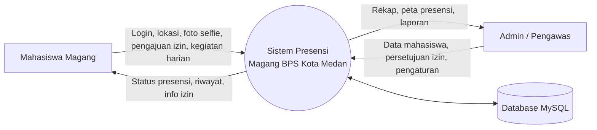
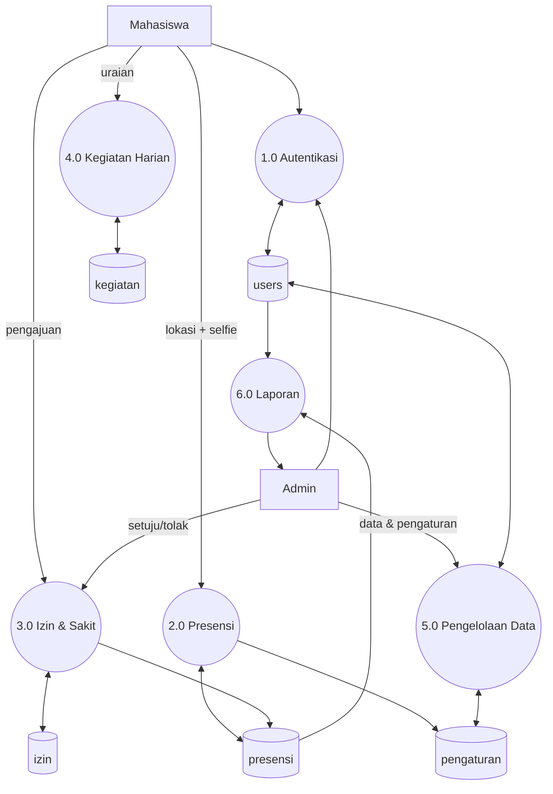

# Data Flow Diagram (DFD)

Gunakan diagram di bawah sebagai acuan untuk digambar ulang di draw.io / Visio untuk laporan. Tampilan teks Mermaid bisa dilihat di VS Code (ekstensi Markdown Preview Mermaid) atau mermaid.live.

## DFD Level 0 (Diagram Konteks)

## DFD Level 1

| Proses | Nama proses | Masukan | Keluaran | Data store |
|---|---|---|---|---|
| 1.0 | Autentikasi | Username, password | Sesi login (role admin/mahasiswa) | users |
| 2.0 | Presensi (Clock In/Out) | Koordinat GPS, foto selfie | Status hadir/terlambat, jarak, foto tersimpan | presensi, pengaturan |
| 3.0 | Pengelolaan izin & sakit | Pengajuan izin, persetujuan admin | Status izin, catatan di rekap presensi | izin, presensi |
| 4.0 | Kegiatan harian | Uraian kegiatan | Daftar kegiatan | kegiatan |
| 5.0 | Pengelolaan data | Data mahasiswa, pengaturan kantor | Akun, radius, jam masuk | users, pengaturan |
| 6.0 | Laporan | Filter tanggal/bulan | Rekap harian, bulanan, per universitas, keterlambatan, peta | presensi, users, izin |

