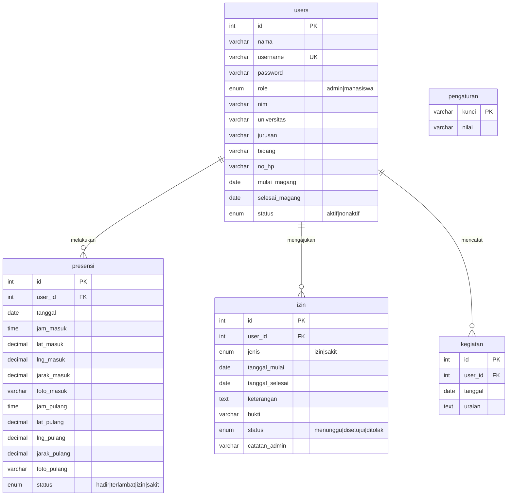

# ERD dan Struktur Tabel

## Keterangan tabel

- **users**: akun admin dan mahasiswa magang. Password disimpan dengan `password_hash` (bcrypt).
- **presensi**: satu baris per mahasiswa per hari (kunci unik `user_id + tanggal`). Menyimpan waktu, koordinat, jarak dari kantor, dan path foto untuk Clock In dan Clock Out.
- **izin**: pengajuan izin/sakit. Jika disetujui, sistem mencatat status izin/sakit pada hari kerja di tabel presensi.
- **kegiatan**: logbook harian mahasiswa.
- **pengaturan**: koordinat kantor, radius, jam masuk, batas terlambat, jam pulang.

Foto selfie disimpan sebagai file di folder `uploads/selfie/TAHUN/BULAN/`, database hanya menyimpan path-nya.
